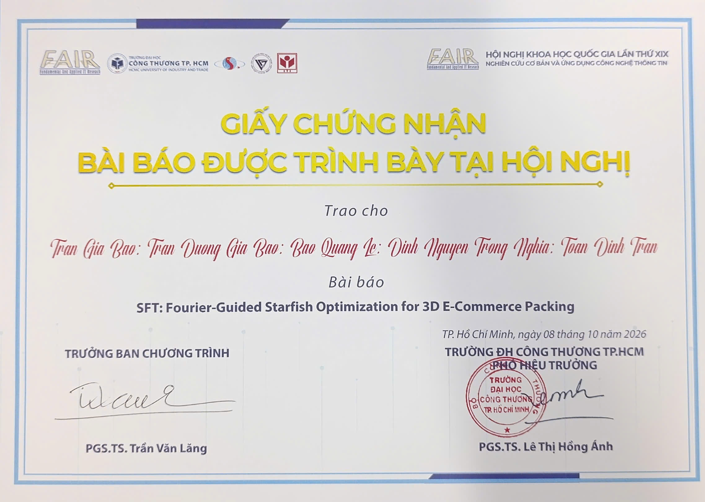

 

 

&nbsp;

 

---

## 👨‍💻 About Me

I'm **Lê Quang Bảo**, an Information Technology student at **Ho Chi Minh City University of Industry and Trade (HUIT)**.

I enjoy building applications, learning new technologies, and turning ideas into practical software projects.

My current interests include:

- 🌐 Web Development
- 📱 Mobile Application Development
- 💻 Software Engineering
- 🗄️ Database Design & Management
- ⚙️ Backend Development
- 🤖 Machine Learning & Artificial Intelligence

I am continuously improving my programming skills through academic projects, personal projects, and teamwork.

---

## 🎯 Current Focus

<table>
<tr>
<td width="50%">

### 🌐 Web Development

Building modern web applications and learning how to organize applications using MVC architecture.

Technologies:

`HTML` · `CSS` · `JavaScript`  
`ASP.NET MVC` · `Laravel`

</td>

<td width="50%">

### 📱 Mobile Development

Developing mobile applications and learning how to connect mobile apps with backend services and databases.

Technologies:

`Flutter` · `Dart` · `Firebase`

</td>
</tr>

<tr>
<td width="50%">

### 🗄️ Database & Backend

Designing relational databases and connecting applications with backend data services.

Technologies:

`SQL Server` · `MySQL` · `PostgreSQL`

</td>

<td width="50%">

### 🤖 AI & Machine Learning

Learning the fundamentals of Machine Learning through academic projects and practical experiments.

Technologies:

`Python` · `SVM` · `Random Forest`

</td>
</tr>
</table>

---

# 🛠️ Tech Stack

## 💻 Programming Languages

---

## 🌐 Web Development

**Technologies & Frameworks**

`HTML5` · `CSS3` · `JavaScript` · `ASP.NET MVC` · `Laravel`

---

## 📱 Mobile Development

`Flutter` · `Dart` · `Firebase` · `Android`

---

## 🗄️ Databases

`SQL Server` · `MySQL` · `PostgreSQL` · `Firebase`

---

## ⚙️ Development Tools

`VS Code` · `Visual Studio` · `Git` · `GitHub` · `Docker` · `Postman`

---

# 🚀 Highlight Projects

## 🍽️ European-Style Restaurant Website

A modern restaurant website designed to simulate the fundamental operations of a restaurant web system.

### Features

- Home page
- Food menu
- Food details
- Table reservation
- Login & Registration
- Contact page
- Admin Dashboard

### Technology

`HTML` · `CSS` · `JavaScript`

🔗 **Repository:**  
https://github.com/Leebao12/Web_Nha_Hang_GENG

---

## ☕ Coffee & Tea Management System

Desktop application designed to support the management of a Coffee & Tea shop.

### Main Functions

- Employee management
- Supplier management
- Inventory management
- Ingredient import
- Product data management
- Database storage and processing

### Technology

`C#` · `WPF` · `SQL Server`

🔗 **Repository:**  
https://github.com/Leebao12/Do_An_Congnghe.NET

---

## 🚗 AEON Tan Phu Parking Management System

A parking lot management application developed to apply **Data Structures & Algorithms** concepts to a practical management problem.

### Main Functions

- Vehicle check-in
- Vehicle check-out
- Vehicle information management
- Searching records
- Adding and deleting records
- File-based data storage
- Stack data structure application

### Technology

`C/C++` · `Data Structures & Algorithms` · `Stack` · `File Handling`

🔗 **Repository:**  
https://github.com/Leebao12/Do_An_DSA_QuanLyBaiXeAEON_Tan_Phu

---

## 📱 Mobile Application Development

Collection of mobile application exercises and projects developed while studying Mobile Application Development.

### Technology

`Flutter` · `Dart`

🔗 **Repository:**  
https://github.com/Leebao12/Mobile-Application-Development

---
# 🏆 Achievements

# 🏆 Achievements

<table>
  <tr>
    <td align="center">
       
      <b>National Scientific Conference FAIR XIX (2026)</b> 
      *Co-author*.***SFT: Fourier-Guided Starfish Optimization for 3D E-Commerce Packing***.*Presented at the 19th National IT Conference*
    </td>
  </tr>
</table>

# 📚 Academic & Development Experience

| Area | Experience |
|---|---|
| 🌐 Web | HTML, CSS, JavaScript, ASP.NET MVC, Laravel |
| 📱 Mobile | Flutter, Dart, Firebase |
| 💻 Desktop | C#, WPF |
| 🗄️ Database | SQL Server, MySQL, PostgreSQL |
| 🧠 Algorithms | C/C++, Data Structures & Algorithms |
| 🤖 Machine Learning | Python, SVM, Random Forest |
| ⚙️ Tools | Git, GitHub, Docker, VS Code, Visual Studio |

---

# 📊 GitHub Statistics

 

---

# 📈 Contribution Activity

---

# 🎯 Career Goals

My goal is to become a professional **Software Engineer** capable of designing and developing reliable, user-friendly, and scalable software systems.

I want to continuously improve my knowledge in:

`Software Engineering`  
`Web Development`  
`Mobile Development`  
`Backend Development`  
`Database Systems`  
`Artificial Intelligence`

---

# 🤝 Connect With Me

 

### 💬 Feel free to explore my repositories and connect with me!

⭐ **Thanks for visiting my GitHub profile!**

